# Computer Graphics – Meshes and Shaders

> **To get started:** Clone this repository:
>
>     git clone git@github.com:panuelosj/computer-graphics-csc317-A4-Meshes_and_Shaders.git
>
> **Do not fork:** Clicking "Fork" will create a _public_ repository. If you'd
> like to use GitHub while you work on your assignment, then mirror this repo as
> a new _private_ repository:
> https://stackoverflow.com/questions/10065526/github-how-to-make-a-fork-of-public-repository-private

This assignment covers two related topics. In **Part 1**, you will be building,
analysing and subdividing polygon **meshes**, and in **Part 2** you will be constructing
a shader pipeline for rendering these meshes.

On a GPU, the shading stages are written in a shading language and run per
vertex and per fragment. Here, you will write the same math as plain NumPy functions
that operate on whole arrays of points at once, essentially constructing a "software shader".

## Learning objectives

By completing this assignment you will be able to:

* represent polygon meshes as indexed vertex/face arrays and build
  **adjacency** structures from them;
* compute **per-face**, area-weighted **per-vertex**, and crease-aware
  **per-corner** normals, and explain when each is appropriate;
* generate parametric meshes (a cube and a latitude-longitude **sphere**) and
  write them to the **`.obj`** format;
* implement **Catmull-Clark subdivision** and explain its smoothing behaviour;
* build 4×4 homogeneous **transformation matrices** (translate, scale,
  rotate) and compose them into model transforms;
* implement **Blinn-Phong** shading as a vectorized function over surface
  points;
* synthesise procedural texture from **Perlin-style gradient noise** and
  smooth-step interpolation;
* compose those pieces into a **procedural planet** of your own design;
* perturb normals with a **bump map** using a tangent frame and finite
  differences.

## Prerequisite knowledge

* **Math**: cross products and triangle areas; homogeneous coordinates and
  matrix composition; spherical coordinates / trigonometry; finite-difference
  derivatives.
* **Programming**: vectorized `numpy` over `(n, 3)` arrays; dictionaries for
  edge lookup (subdivision).
* **Course**: A2's Blinn-Phong model returns here as a software shader; A1's
  array and colour conventions are assumed.

### Prerequisite installation and setup

This assignment ships with everything it needs. From the **root of this
repository**, create its virtual environment once:

```bash
./init.sh            # macOS / Linux
# or, on Windows (PowerShell):
.\init.ps1
```

That creates `./venv` here and installs the dependencies (`numpy`, `pillow`,
`scipy`, `polyscope`). Then activate it in every new shell:

```bash
source venv/bin/activate           # macOS / Linux
# .\venv\Scripts\Activate.ps1      # Windows
```

Each assignment has its own `venv`, so activate the one belonging to the
assignment you are working on.

### Layout

    README.md            this file: background, tasks, and grading
    init.sh / init.ps1   one-time setup: creates ./venv and installs deps
    main.py              the main script that runs your code end-to-end
    run_tests.py         runs the unit checks and reports how many pass
    check_my_work.py     the same checks, but weighted by each function's allocated marks
    export_expected.py   exports the public tests' inputs and expected outputs as readable text and images
    cgcommon/            code shared by every assignment (do not edit)
    src/                 one file per function that YOU implement
    backend/             scene loading + the gradient noise you may import (do not edit)
    tests/               the unit checks and their reference results (do not edit)
    tests/expected/      the public test data, readable (INDEX.md, .txt, .png)
    docs/images/         the sample results shown in this README
    data/                sample input meshes

The `src/` directory contains *empty implementations* (stubs) of the functions
you must write. **This is the only directory you edit.** Each file documents the
function's inputs, outputs, and the algorithm. Do **not** change `tests/`.

### Conventions

* A mesh is a pair `(V, F)`: vertex positions `V` are an `(n, 3)` float array,
  faces `F` are an `(m, 3)` int array for triangles or `(m, 4)` for quads, with
  **0-indexed** vertex indices.
* Shading functions are vectorized: they accept `(k, 3)` arrays of points,
  normals and directions so the backend can shade a whole mesh at once.

### Running the demo

```bash
python main.py --mode generate          # write cube + sphere OBJs to out/
python main.py --mode normals           # per-face/vertex/corner normals
python main.py --mode subdiv            # Catmull-Clark subdivision
python main.py --mode shade             # procedural colour + bump normals
```

Each mode opens an interactive [polyscope](https://polyscope.run) window. On a
machine with no display, add `--headless` and the backend saves data / an image
to `out/` instead.

Scene renders take two size controls, and they do different jobs:

```bash
python main.py --scene planet-and-moon --headless --size 1000   # more pixels
python main.py --scene planet-and-moon --headless --detail 3    # more vertices
```

Procedural colour is computed **per vertex** and interpolated across each quad,
so a coarse sphere smears the pattern no matter how large the image is:
`--detail` multiplies the tessellation and is what actually sharpens the
texture. The scene files stay modest so the interactive viewer keeps up — turn
`--detail` up for a still.

Interactive controls:

* **normals** — radio buttons switch between per-face / per-vertex /
  per-corner normals; a slider changes the per-corner crease threshold and
  recomputes live.
* **subdiv** — the *subdivide* button applies one Catmull-Clark iteration in
  place (like `[space]`), *reset* restores the control mesh (like `R`).
* **shade** — a moon built from **your** `rotate_about_y`, `translate` and
  `uniform_scale` matrices orbits the planet; the light circles over time;
  a checkbox toggles your bump mapping on and off.

### Checking your work

This repo ships with two tools that could potentially be useful for working on 
this assignment: `run_tests.py` and `check_my_work.py`.

```bash
python run_tests.py                  # PASS/FAIL table + "Validated X/15"
python run_tests.py --only catmull_clark   # focus on a single function
python check_my_work.py              # scores your implementation
```

`run_tests.py` tells you *what* is broken. `check_my_work.py` runs the same
checks but reports them as marks per function, so you can see where you stand
before submitting. Keep going until you see `Validated 16/16`. Note that the 
function only marks it against the public unit tests, we will also validate 
against internal examples that are not released in this repo. 

When a check fails and the message alone is not enough, look at the data it
used: [`tests/expected/`](tests/expected/INDEX.md) holds every input and
expected output the public tests compare against, written out as readable text
(and as `.png` images where the array is a picture).
You can also load the fixture directly:

```python
import numpy as np
g = np.load("tests/golden/a4_golden.npz")
print(g.files)        # every array the tests use
g["<name>"]           # one of them
```

## Sample results

**Scenes.** Everything below is built and shaded by your own functions —
geometry from `sphere`/`cube`/`catmull_clark`, placement from your
matrices, colour from `procedural_color`, `blinn_phong`, and `planet_color`. Run them with
`python main.py --scene <name>`:

| `planet-and-moon` | `three-moons` |
|:---:|:---:|
| 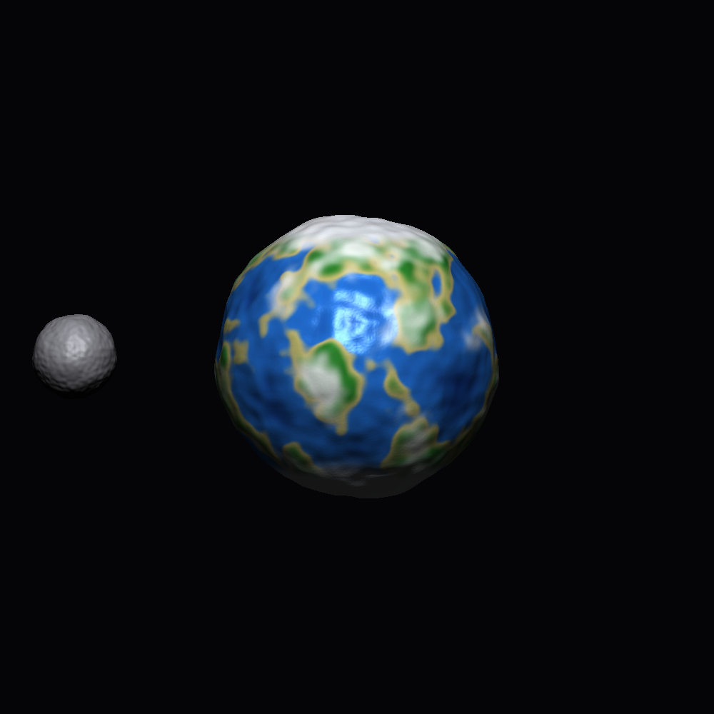 | 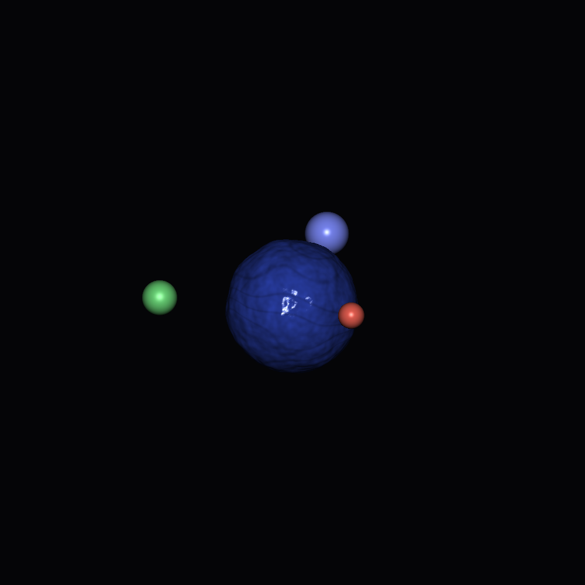 |

| `marble-cube` | `bob-lit` |
|:---:|:---:|
| 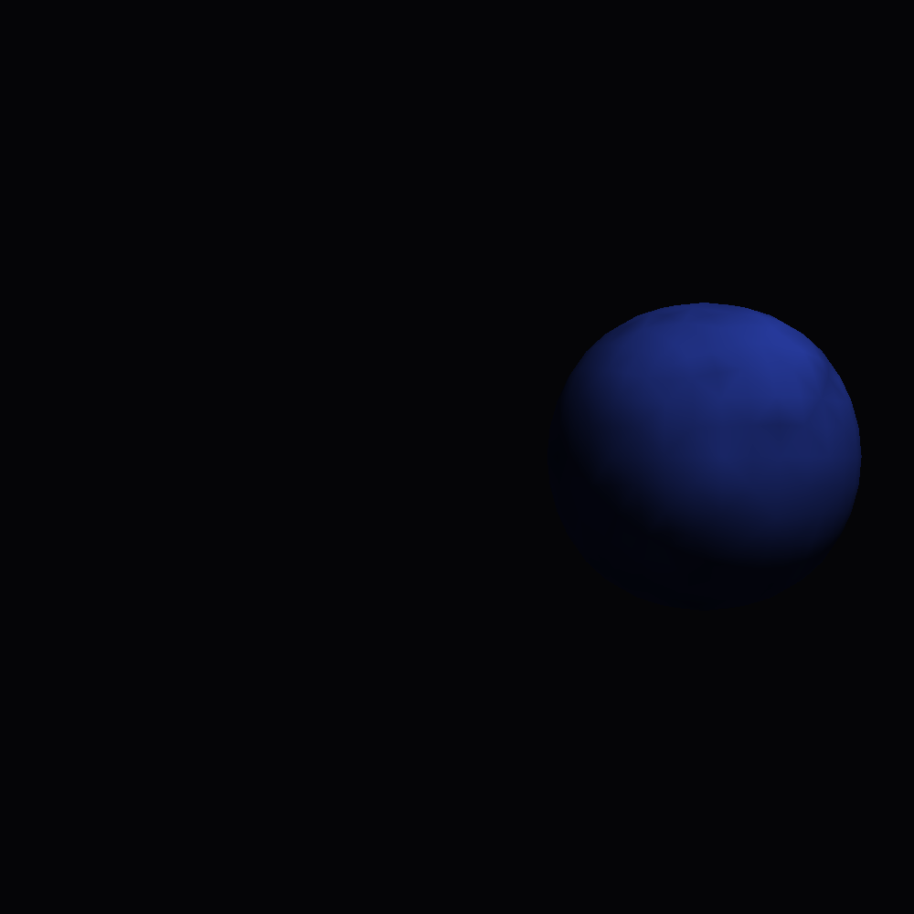 | 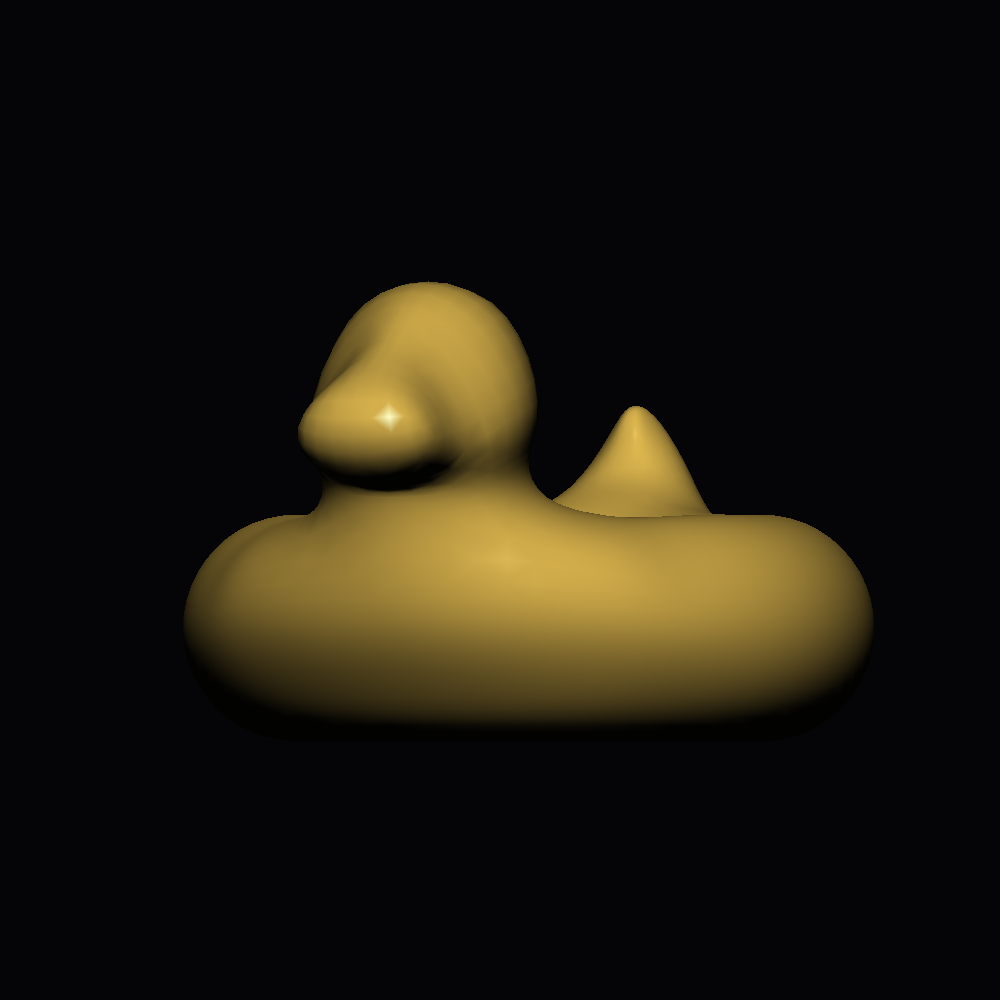 |

`keyframed-orbit` is driven by your `catmull_rom_interpolation`: the moon and
the small probe are given positions at a handful of key times, and the spline
supplies every frame in between.

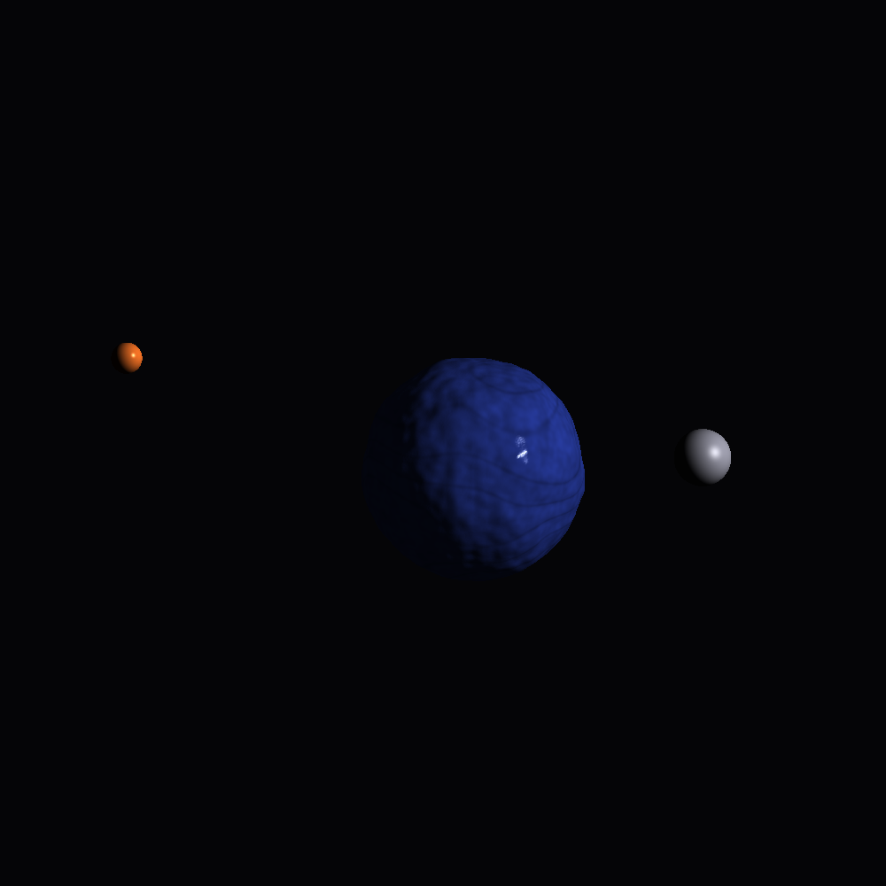

These come from plain `.json` files in
[`data/scenes/`](data/scenes/README.md) — see **Scene files** below.

## Background

### Read Section 12.1 and skim Chapter 11 of _Fundamentals of Computer Graphics (4th Edition)_.

There are many ways to store a triangle (or polygonal) mesh on the computer. At
the heart of these structures is the problem of storing the two types of
information defining a mesh: the _geometry_ (where points on the surface are
located in space) and the _connectivity_ (which points are connected to each
other). The connectivity is also sometimes referred to as the
[topology](https://en.wikipedia.org/wiki/Topology) of the mesh.

The [graphics pipeline](https://en.wikipedia.org/wiki/Graphics_pipeline) works
on a per-triangle and per-vertex basis. So the simplest way to store geometry is
a 3D position for each `i`-th vertex of the mesh, and to store triangle
connectivity as an ordered triplet of indices referencing vertices: `[i, j, k]`
defines a triangle with corners at vertices `i`, `j` and `k`. We put the `n`
vertex positions in the rows of a real-valued matrix `V` (`n×3`) and the `m`
connectivity triplets in the rows of an integer matrix `F` (`m×3`).

> **Question:** What changes if we want to store a (pure-)quad mesh? (Answer:
> `F` becomes `m×4`.)

### Normals

For a smooth surface, knowing the surface geometry (i.e., position in space)
near a point fully determines the [normal
vector](https://en.wikipedia.org/wiki/Normal_(geometry)) at that point.

For a discrete mesh, the normal is only well-defined in the middle of planar
faces (e.g., inside the triangles of a triangle mesh, but not along the edges or
at vertices). Furthermore, if we use these normals for rendering, the surface
will have a faceted appearance. This appearance is mathematically correct, but
not necessarily desired if we wish to display a smooth looking surface.

[Phong](https://en.wikipedia.org/wiki/Bui_Tuong_Phong) realized that [linearly
interpolating](https://en.wikipedia.org/wiki/Linear_interpolation) normals
stored at the corners of each triangle leads to a [smooth
appearance](https://en.wikipedia.org/wiki/Phong_shading#Phong_interpolation).

This raises the question: what normals should we put at vertices or corners of
our mesh?

For a faceted surface (e.g., a cube), all corners of a planar face $f$ should
share the face's normal $\mathbf{n}_f \in \mathbb{R}^3$ .

For a smooth surface (e.g., a sphere), corners of triangles located at the same
vertex should share the same normal vector. This way the rendering is continuous
across the vertex. A common way to define per-vertex normals is to take a
weighted average of normals from incident faces. Different weighting schemes are
possible: uniform average (easy, but sensitive to irregular triangulations),
angle-weighted (geometrically well motivated, but not robust near zero-area
triangles), area-weighted (geometrically reasonable, well behaved). In this
assignment, we'll compute area-weighted per-vertex normals:

$$\mathbf{n}_v = \frac{\sum\limits_{f\in N(v)} a_f \mathbf{n}_f}{\left\|\sum\limits_{f\in N(v)} a_f \mathbf{n}_f\right\|},$$

where $N(v)$ is the set of faces neighboring the $v$-th vertex.

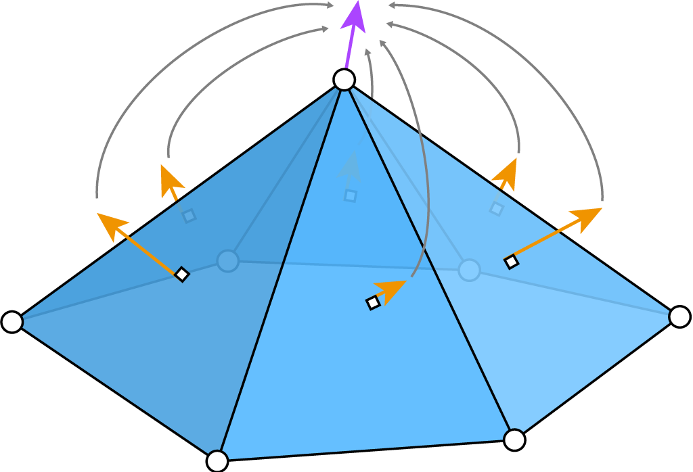

_Unique triangle normals (orange) are well-defined. We can define a notion of a
normal for each vertex (purple) by taking a (weighted) average of normals from
incident triangles._

For surfaces with a mixture of smooth-looking parts and creases, it is useful to
define normals independently for each triangle corner (as opposed to each mesh
vertex). For each corner, we'll again compute an area-weighted average of normals
triangles incident on the shared vertex at this corner, but we'll ignore
triangle's whose normal is too different from the corner's face's normal:

$$\mathbf{n}_{f,c} =
\frac{\sum\limits_{g\in N(v)\,|\,\mathbf{n}_g\cdot\mathbf{n}_f>\epsilon} a_g \mathbf{n}_g}{\left\|\sum\limits_{g\in N(v)\,|\,\mathbf{n}_g\cdot\mathbf{n}_f>\epsilon} a_g \mathbf{n}_g\right\|},$$

where $\epsilon$ is the minimum dot product between two face normals before we
declare there is a crease between them.

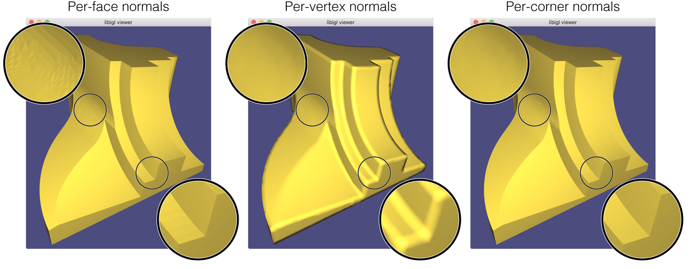

_`python main.py --mode normals` opens a viewer whose radio buttons switch
between normal types. Notice that per-face has sharp corners, but a faceted
appearance in the curved regions; the per-vertex has nice smooth regions but
ugly corners where averaging acts up; and per-corner is the best of both
worlds._

### .obj File Format

The [.obj file format](https://en.wikipedia.org/wiki/Wavefront_.obj_file) is a
_face_-based representation of a mesh. The connectivity/topological data is
stored implicitly by a list of a faces whose corners can _share_ geometric
information.

There are three main types of geometric information stored at vertices:

  - 3D position information (let's call it `V`),
  - 3D normal vector information (let's call it `NV`), and
  - 2D parameterization information (let's call it `UV`).

Faces know where to find the position, normal and parameterization information
for each corner by following a pointer/index. For a given corner of a given
face, the index for position, normal or parameterization information may be
different.

> **Warning:** Python indices start at `0`, but in a .obj file the first element
> in a list has index `1`. Add one when you write, subtract one when you read.

##### Cube example

In this way, the quadrilateral faces of a cube mesh may use 8 unique
3D vertex positions, giving the appearance of a connected surface when visualized
in 3D. The same set of faces may use 14 unique 2D parameterization positions,
giving the appearance of a cross with a boundary when visualized in 2D. Finally,
that same set of faces may use only 6 unique 3D normal vectors.

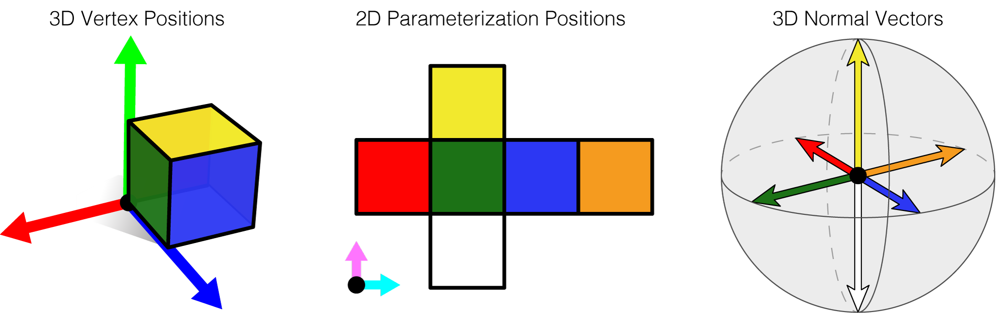

In this assignment we write only the positions and faces — the `(V, F)` core.

### Cube and sphere

A cube can be described with 8 unique 3D vertex positions and 6 quad faces.
(The full textured version would also use 14 unique 2D parameterization
coordinates and 6 unique normals, but here we keep the `(V, F)` core.)

A latitude–longitude **sphere** is swept out as a grid of `num_u × num_v` quads.
For a parameter point `(u/num_u, v/num_v)` we use

    phi   = 2π − 2·(u/num_u)·π
    theta =  π −   (v/num_v)·π
    p     = ( sin θ cos φ,  cos θ,  sin θ sin φ )

wrapping the longitude index modulo `num_u` to sew the seam shut and collapsing
the top/bottom rings to single pole vertices, so the surface is watertight and
all vertices lie exactly on the unit sphere.

### Subdivision Surfaces

A [subdivision surface](https://en.wikipedia.org/wiki/Subdivision_surface) is a
natural generalization of a [spline
curve](https://en.wikipedia.org/wiki/Spline_(mathematics)). A smooth spline can
be defined as the [limit](https://en.wikipedia.org/wiki/Limit_(mathematics)) of
a [recursive
process](https://en.wikipedia.org/wiki/Recursion_(computer_science)) applied to
a polygon: each edge of the polygon is split with a new vertex and the vertices
are smoothed toward eachother. If you've drawn smooth curves using Adobe
Illustrator, PowerPoint or Inkscape, then you've used splines.

At a high-level, subdivision surfaces work the same way. We start with a
polyhedral mesh and subdivide each face. This adds new vertices on the faces
and/or edges of the mesh. Then we smooth vertices toward each other.

The first and still (most) popular subdivision scheme was invented by
[Catmull](https://en.wikipedia.org/wiki/Edwin_Catmull) (who went on to co-found
[Pixar](https://en.wikipedia.org/wiki/Pixar)) and
[Clark](https://en.wikipedia.org/wiki/James_H._Clark) (founder of
[Silicon Graphics](https://en.wikipedia.org/wiki/Silicon_Graphics) and
[Netscape](https://en.wikipedia.org/wiki/Netscape)). [Catmull-Clark
subdivision](https://en.wikipedia.org/wiki/Catmull–Clark_subdivision_surface) is
defined for inputs meshes with arbitrary polygonal faces (triangles, quads,
pentagons, etc.) but always produces a pure-quad mesh as output (i.e., all faces
have 4 sides).

To keep things simple, in this assignment we'll assume the input is also a
pure-quad mesh.

One iteration replaces every quad with four, placing:

* a **face point** at the centroid of each face;
* an **edge point** for each edge, the average of its two endpoints and the two
  neighbouring face points;
* a **moved original vertex** $P' = (Q + 2R + (k-3)P)/k$, where $Q$ is the
  average of the touching face points, $R$ the average of the incident edge
  midpoints, and $k$ the vertex's valence.

`python main.py --mode subdiv` loads the quad control mesh in `data/bob.obj`
and shows it converging toward a smooth surface as the iterations accumulate.
The cage is drawn so you can watch each quad split into four:

| control cage | 1 round | 2 rounds | 3 rounds |
|:---:|:---:|:---:|:---:|
| 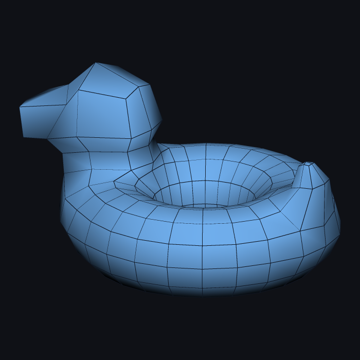 | 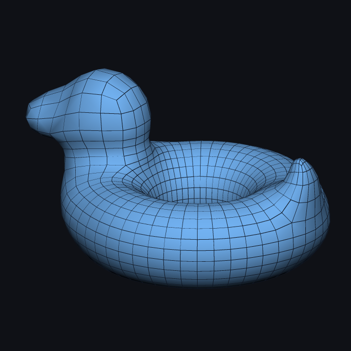 | 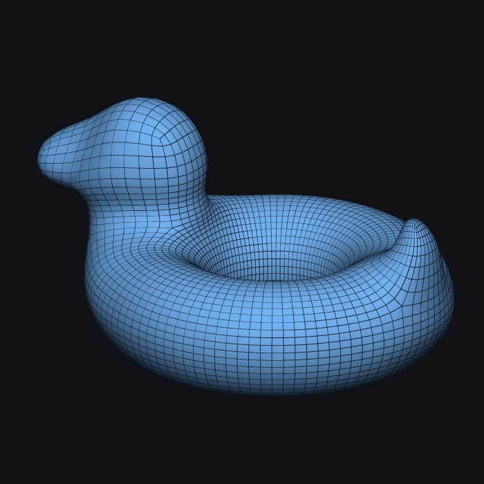 | 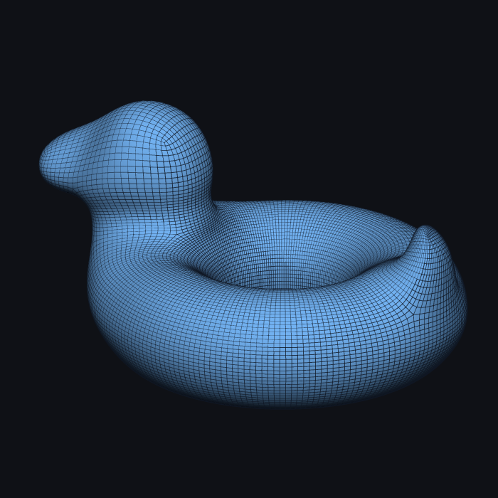 |

## Part 1 Tasks

> Every assignment, including this one, will contain a **Tasks** section. This will
> enumerate all of the tasks a student will need to complete for this assignment.

> Implementations of nearly any task you're asked to implemented in this course can be found 
> online. AI can also now fairly reliably accomplish these tasts. Do not copy these and avoid 
> googling for code or using AI; instead, search the internet for explanations. Many topics 
> have relevant wikipedia articles. Use these as references. Always remember to cite any 
> references in your comments.


| File | Marks | What it does |
| ---- | ----: | ------------ |
| `src/write_obj.py` | 7 | Write a tri/quad mesh to a 1-indexed `.obj`. |
| `src/cube.py` | 7 | The 8-vertex / 6-quad unit cube. |
| `src/sphere.py` | 7 | A `num_u × num_v` lat-long quad sphere. |
| `src/triangle_area_normal.py` | 7 | `0.5·(b−a)×(c−a)` (area-weighted normal). |
| `src/per_face_normals.py` | 7 | Unit normal per triangle. |
| `src/per_vertex_normals.py` | 6 | Area-weighted per-vertex normals. |
| `src/vertex_triangle_adjacency.py` | 6 | Faces incident on each vertex. |
| `src/per_corner_normals.py` | 5 | Crease-aware per-corner normals. |
| `src/catmull_clark.py` | 5 | Catmull-Clark quad subdivision. |

---

# Part 2: Shading

## Background

### Review Chapters 6, 7 and Sections 8.1–8.2; read Sections 11.4–11.5 and Chapter 17 of _Fundamentals of Computer Graphics (4th Edition)_.

In the real-time rendering pipeline, the **vertex** stage transforms each vertex
through a chain of matrices and the **fragment** stage computes a colour for
each pixel. You implement both stages as NumPy functions that operate on arrays
of points, so a single call shades an entire mesh.

### Model / view / projection

When working with [perspective
projection](https://en.wikipedia.org/wiki/3D_projection#Perspective_projection)
it is convenient to use 4D [homogeneous
coordinates](https://en.wikipedia.org/wiki/Homogeneous_coordinates): a 3D point
`p` becomes `(p, 1)`. A vertex's clip-space position is

    p_clip = proj · view · model · (p, 1)

The **model** matrix places an object in the world (built from `translate`,
`uniform_scale`, and `rotate_about_y`), the **view** matrix maps world space into
camera space, and the **projection** matrix applies perspective. We leave the
result in homogeneous coordinates (no perspective division) just as the GPU
vertex shader does. The y-axis rotation matrix is

    R_y(θ) = [[ cos θ, 0, sin θ, 0],
              [     0, 1,     0, 0],
              [−sin θ, 0, cos θ, 0],
              [     0, 0,     0, 1]]

### Blinn-Phong shading

Given a material (`ka`, `kd`, `ks`, exponent `p`), a surface normal `n`, a
view direction `v` and a light direction `l`, with a white light of
low ambient intensity `Ia = 0.1`, the Blinn-Phong colour is

    color = ka·Ia
          + kd·max(l·n, 0)                       (diffuse)
          + ks·max(h·n, 0)^p,   h = normalize(v + l)   (specular)

The half-vector `h` is what makes this the *Blinn*-Phong model.

### Value / gradient (Perlin) noise

You do not implement this one — it is provided for you as
`backend/noise.py`. Import it wherever you need it:

```python
from backend.noise import perlin_noise

n = perlin_noise(P)          # P is (k, 3); returns (k,)
```

It is worth understanding what it does, because the shaders you *do* write are
built on top of it. You can refer to [Perlin noise](https://en.wikipedia.org/wiki/Perlin_noise) ("gradient noise"). Essentially, this is a function that produces a smooth pseudorandom field. 

### Procedural texturing

By layering noise at several frequencies and feeding it through `sin`, `pow`,
`clamp` and `smooth_step`, we can paint complex patterns using only the surface 
position as input. Because the pattern depends only on the object-space position 
(not the view or model transform), it stays "painted on" the model as the scene animates.

### Bump mapping

A **bump map** is a mapping from a surface point to a displacement along the
normal. A **normal map** is a mapping from a surface point to a unit normal.
Normal mapping lets us drape the appearance of a complex surface onto a low
resolution one. To build a believable normal map, first generate a plausible
bump map: each point `p` (with mathematically correct normal `n(p)`) moves to

    p̃ = p + h(p)·n(p)

where `h` is the bump-height function. If `h` is smooth, we can compute the
_perceived_ normal `ñ` with a small [finite
difference](https://en.wikipedia.org/wiki/Finite_difference). Pick orthogonal
tangent and bi-tangent vectors `T`, `B` in the tangent plane at `p` and a small
`ε` (e.g. `1e-4`):

    ñ = ( p̃(p + εT) − p̃(p) ) × ( p̃(p + εB) − p̃(p) ),   then normalize ñ.

> **Question:** can we always recover _some_ orthogonal tangents `T`, `B` from a
> unit normal `n`? (Yes — project any fixed axis onto the tangent plane, with a
> fallback axis when the normal is parallel to it.)

### Animating with keyframes

Setting a value for every frame by hand is infeasible, so animation specifies
values at a few **key** times and interpolates between them. Linear
interpolation gives choppy, robotic motion; a **Catmull-Rom** spline gives
smooth motion that still passes exactly through every key.

Catmull-Rom is a cubic Hermite spline whose tangent at each key is the
**centred difference** across that key's neighbours, scaled by `tau = 0.5`:

    m_i = tau·(P_{i+1} − P_{i−1})

so for the segment running from `k1` to `k2 = k1+1`

    D1 = tau·(P_{k2}   − P_{k1−1})
    D2 = tau·(P_{k2+1} − P_{k1})

At the ends of the sequence the missing neighbour is taken to be the endpoint
itself (equivalently: duplicate it), which reduces the tangent to the one-sided
`tau·(P_{k2} − P_{k1})`. Then evaluate the Hermite cubic

    h00 = 2s³ − 3s² + 1     h10 = s³ − 2s² + s
    h01 = −2s³ + 3s²        h11 = s³ − s²

    p(s) = h00·P1 + h10·D1 + h01·P2 + h11·D2

Outside the keyframe range, clamp to the nearest endpoint value.

The function interpolates a **vec3**, which covers a position, a colour or a
triple of Euler angles. Scenes use it through a `translate_keys` transform (see
**Scene files** below), and the sample scene `keyframed-orbit` puts a moon and a
probe on keyframed paths — a good way to check your work by eye, since a wrong
tangent shows up immediately as a kink at the keys where the correct curve
glides through.

> The same routine smooths the skeleton animations in Assignment 5, where it
> interpolates joint angles rather than positions.

### Your own planet

While other implemented functions are graded strictly objectively against the
reference unit tests, `planet_color` will be graded subjectively, and will
involve some creativity.

You need to build a planet. 
It does not need to look like Earth, and it does not need to
look like the example below, we just show what one possible planet shader could look like. 
Everything you have written is available to you: 
`bump_height` can double as an **elevation** field 
(that can also distinguish between ocean and land),
`perturbed_normal` gives you terrain-aware lighting, `blinn_phong` takes
per-point `ka`/`kd`/`ks` so water can be glossy while rock is matte, and
`perlin_noise` is provided. The `time` argument is the scene clock, so clouds
can drift and seasons can turn.

> **Hint:** sprinkle noise on *everything* — diffuse colour, specular colour,
> normals, specular exponent, and colour over time.

```bash
python main.py --scene planet-and-moon
```


*One possible planet: elevation from `bump_height` drives ocean/land, latitude
adds ice caps, and a second noise stack paints drifting clouds. Yours should
look like yours.*

**How it is marked.** The automatic check only asks whether you attempted it:
that it runs, returns one finite colour per point, and varies across the
surface instead of returning a flat fill. It does **not** compare against a
reference, so you cannot get it "wrong" by being different. The remaining
marks are awarded by a human looking at your render, so make something worth
looking at.

## Part 2 Tasks

| File | Marks | What it does |
| ---- | ----: | ------------ |
| `src/model_view_projection.py` | 7 | `translate`, `uniform_scale`, `rotate_about_y`, MVP. |
| `src/blinn_phong.py` | 7 | Blinn-Phong shading (vectorized). |
| `src/smooth_step.py` | 5 | Cubic and quintic smooth-step. |
| `src/procedural_color.py` | 6 | Layered-noise surface colour. |
| `src/bump_mapping.py` | 6 | Bump height, tangent frame, perturbed normals. |
| `src/planet_color.py` | 6 | **Your own procedural planet — open-ended.** |
| `src/catmull_rom_interpolation.py` | 6 | Catmull-Rom (cubic Hermite) interpolation of vec3 keyframes. |

**Total: 100 marks** (Part 1: 57, Part 2: 43).

> **Tip:** `procedural_color` builds on `blinn_phong` and on
> the provided `perlin_noise`; the normal functions depend on
> `triangle_area_normal`. Implement the dependencies first.

## Scene files

The `--scene` mode builds a scene described by a plain `.json` file, using
**your** functions for every part of it: geometry from `sphere` / `cube` /
`catmull_clark`, placement from `translate` / `uniform_scale` /
`rotate_about_y`, and colour from `procedural_color`, `blinn_phong` and the
bump-mapping pair. A scene therefore only looks right once the functions it
uses are correct, which makes it a quick way to *see* your code working.

```bash
python main.py --scene three-moons              # interactive viewer
python main.py --scene three-moons --headless   # save a .png (+ .obj per object)
python main.py --scene three-moons --time 2.5   # jump to t = 2.5 s
python main.py --scene path/to/my-scene.json    # your own file
```

Five samples ship in [`data/scenes/`](data/scenes/README.md):
`planet-and-moon`, `three-moons`, `marble-cube`, `bob-lit` and
`keyframed-orbit` (all shown above). A minimal scene looks like this:

```json
{
  "name": "One planet",
  "view": [0, 0, 1],
  "camera": { "center": [0, 0, 0], "extent": 1.3 },
  "light": { "type": "orbiting", "period": 8.0, "elevation": 0.6 },
  "objects": [
    {
      "name": "planet",
      "geometry": { "type": "sphere", "nu": 48, "nv": 32 },
      "shading":  { "type": "procedural", "bump": true },
      "transform": [ { "rotate_about_y": 0, "period": 10.0 } ]
    }
  ]
}
```

`camera` fixes what the frame shows (`center`) and how wide it is (`extent`).
Omit it and the renderer re-fits every frame, which makes an animated scene
zoom and drift as things move; every sample scene ships one fitted across its
whole loop.

[`data/scenes/README.md`](data/scenes/README.md) documents every field:
geometry types (`sphere`, `cube`, `obj`, with optional `subdivide`), shading
types (`procedural`, `blinn_phong`, `solid`, with optional `bump`), transform
steps and how to animate them, and which of your functions each one calls.

> **Bonus marks.** Writing your own scene is the bonus exercise for this
> assignment. Copy a sample, rename it, and build something: a moon orbiting a
> moon, a subdivided cube beside an un-subdivided one, the same object shaded
> three different ways side by side. Submit the `.json` alongside your `src/`,
> with a sentence in your submission saying what it shows.

## Grading

Your `src/*.py` files are graded by the same unit checks you run locally, mapped
to the marks above, as well as additional internal examples. Submit only your 
`src/` directory (all the `.py` files inside the folder), and your bonus `.json` file. Do not modify `tests/`.

The one exception is `planet_color`, which is open-ended: its automatic check
confirms only that you attempted it, and the rest of its marks come from a
human looking at the render your code produces.

### How your mark is computed

Each function's marks are split between two sets of tests:

| | share | what it is |
|---|---:|---|
| **public** | 30% | the tests in `tests/` that ship with this assignment — the ones `run_tests.py` and `check_my_work.py` run, whose inputs and expected outputs you can read in `tests/expected/` |
| **private** | 70% | the *same* checks run against a different set of inputs |

Both tests are run in the same way, just with different data. Note that the public
test data should be sufficient to fully test your code, the private tests are just
to avoid code that simply reproduces the published numbers but does not actually 
implement the functions asked.

### Submission

Submit your completed homework on MarkUs. Open the [MarkUs](https://markus.teach.cs.toronto.edu/markus) course
page and submit all the `.py` files in your `src/` directory under
Assignment 4: Meshes and Shaders.

### Questions?

Direct your questions to the [Issues page of this
repository](https://github.com/panuelosj/computer-graphics-csc317-A4-Meshes_and_Shaders/issues).

### Answers?

Help your fellow students by answering questions or positions helpful tips on
[Issues page of this
repository](https://github.com/panuelosj/computer-graphics-csc317-A4-Meshes_and_Shaders/issues).
